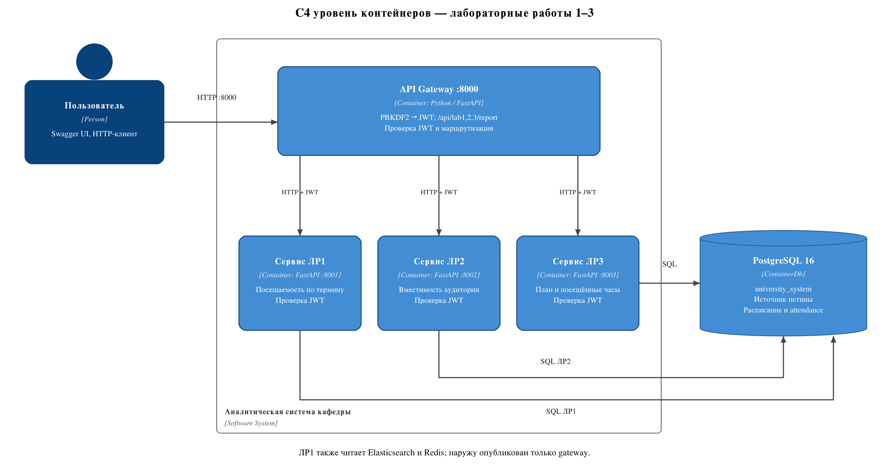
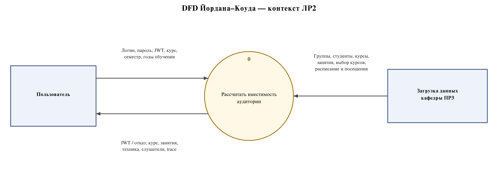
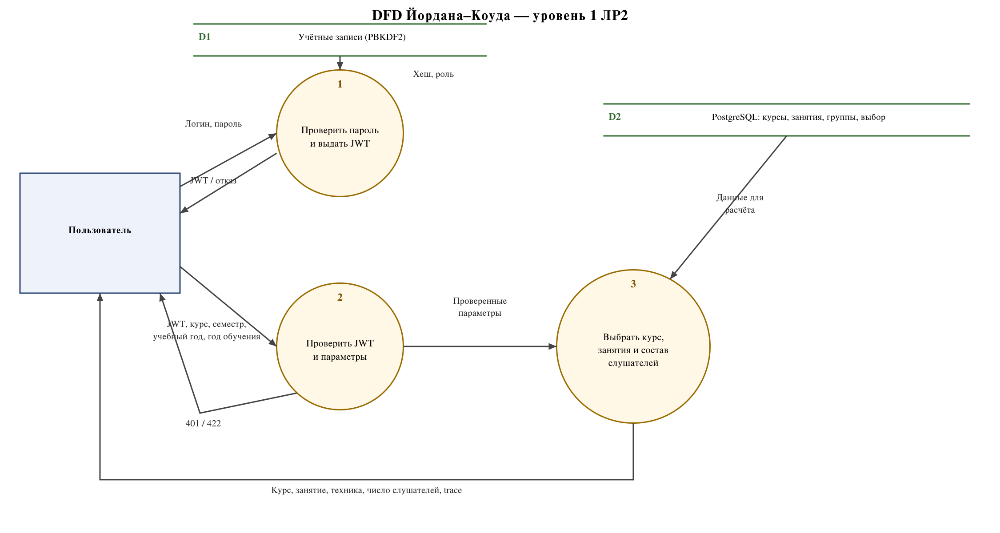

# Лабораторная работа 2

Проектирование архитектуры ПО. Судовский Андрей Леонидович, БСБО-01-23.

## Цель и задание

Получить отчёт о необходимой вместимости аудитории для занятий курса заданного семестра и года обучения. Включить полную информацию о курсе, занятии, технических требованиях и количестве слушателей. Реализовать отдельный HTTP-сервис, JWT-аутентификацию через API Gateway, архитектурные схемы и протокол проверки.

## Архитектура

Контейнер lab2-service слушает внутренний порт 8002. API Gateway публикует порт 8000 и вызывает сервис по сети practice01_default. Оба приложения проверяют JWT. Общая сборка образа сохраняет единые версии зависимостей, а разные команды запуска обеспечивают отдельные процессы и контейнеры.

В DFD процесс обозначен окружностью, внешняя сущность — прямоугольником, хранилище — парой горизонтальных линий. Контекстный процесс раскрывается в проверку учётной записи, проверку JWT/параметров и формирование выборки.

## Структура хранения и метод выборки

Основное хранилище PostgreSQL university_system содержит lecture_courses, lectures, student_groups, students и student_electives. Курс связан со специальностью; группы той же специальности образуют потенциальный состав слушателей. Обязательный курс слушают все активные студенты соответствующего набора, выборный — только записавшиеся.

Выбор PostgreSQL обусловлен необходимостью точного подсчёта по структурированным связям. Используются существующие индексы specialty_id, group_id и первичный ключ student_electives. Отдельные копии в графовой или документной СУБД не нужны для этого запроса. Условия параметризованы драйвером psycopg. Сервис возвращает полный JSON курса и занятия; описание технических средств находится в lecture.tech_requirements.

Вместимость считается для общего занятия потока выбранного года обучения, суммируя слушателей групп этой специальности. Это заявленная политика расчёта, а не оптимизация рассадки по фактическим аудиториям расписания.

## API

GET `/api/lab2/report` принимает course_id (UUID), semester (1–12), study_year (1–6), academic_year (год начала учебного года), trace (bool). Семестр должен соответствовать году обучения. Для семестра 6, третьего года и учебного года 2025/2026 год набора равен 2023. Каждый элемент classes содержит course, lecture, listeners и groups. Пустой результат допустим для отсутствующего курса или несовпадающего семестра.

## Реализация

app/lab2/main.py создаёт приложение из общей фабрики. app/common/analytical_api.py валидирует параметры и проверяет JWT. app/common/analytics.py выполняет ROOM_SQL. EXISTS проверяет выбор курса без размножения строк; COUNT DISTINCT считает уникальных студентов. LEFT JOIN сохраняет занятия при отсутствии слушателей. app/gateway/main.py пересылает токен и параметры и возвращает 502 при сетевой ошибке.

## Протокол проверки

Синтаксис Python и docker compose config проверены. На изолированном PostgreSQL 18 независимый Python-пересчёт совпал с ASGI HTTP-ответами для всех 12 курсов. Примеры: обязательные курсы направления 38.03.05 — 31 слушатель; выборный NoSQL — 18; бизнес-аналитика — 21; обязательные курсы 09.03.04 — 46, машинное обучение — 29, мобильная разработка — 25. Протокол сохранён в evidence/verify_native.json. Десять локальных контрактных тестов дополнительно проверили JWT, параметры и gateway с подменённым downstream. Docker Engine не стартует из-за HCS_E_HYPERV_NOT_INSTALLED; итоговый сетевой прогон в целевых контейнерах PostgreSQL 16 ещё требуется.

Независимая проверка tests/verify_analytics.py читает исходные таблицы, рассчитывает слушателей каждого курса Python-циклами и сравнивает с HTTP-ответом. Проверяются неправильный UUID, несовместимые семестр/год обучения и отсутствие действительного JWT. Успешный протокол создаётся только после всех сравнений.

## Вывод

Реализован отчёт по вместимости с явной политикой отбора слушателей, техническими требованиями и защищённым HTTP-доступом. Статическая готовность подтверждена; проверка на стенде и финальное оформление остаются открытыми.
