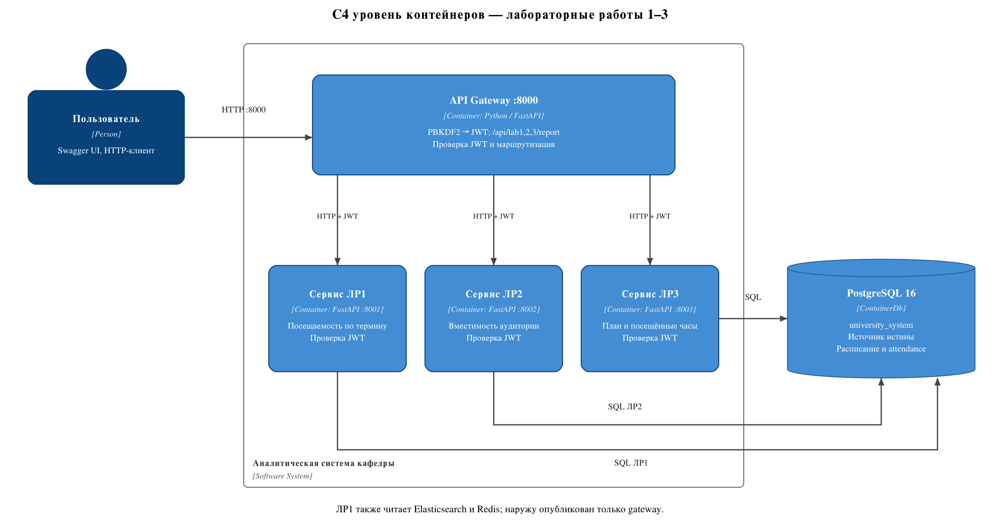
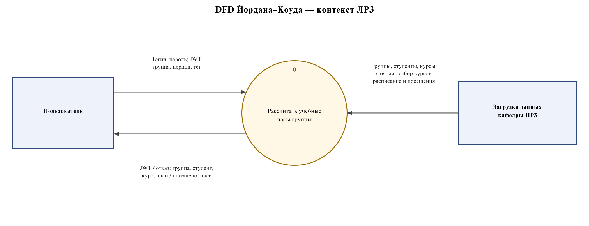
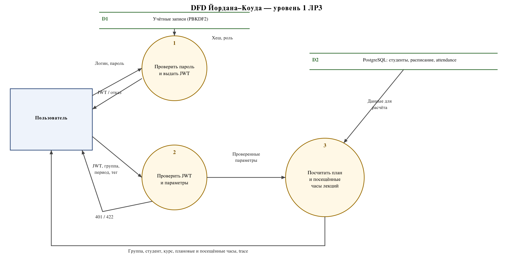

# Лабораторная работа 3

Проектирование архитектуры ПО. Судовский Андрей Леонидович, БСБО-01-23.

## Цель и задание

Получить для заданной группы полную информацию о группе, студентах и курсах, число запланированных и посещённых академических часов. Учитывать только лекции с тегом специальной дисциплины кафедры. Одна лекция соответствует двум академическим часам. Выполнить запрос через защищённый API Gateway и отдельный контейнер сервиса.

## Архитектура

Контейнер lab3-service слушает внутренний порт 8003 и принимает запросы от API Gateway. JWT проверяется и шлюзом, и сервисом. Общий образ содержит весь Python-код; отдельные команды uvicorn запускают независимые приложения.

DFD использует окружности процессов, прямоугольник внешнего пользователя и параллельные линии хранилищ. Процесс 1 получает учётные данные и выдаёт JWT. Процесс 2 проверяет токен и параметры. Процесс 3 получает данные PostgreSQL и формирует часы по парам студент–курс.

## Структура хранения и метод выборки

В PostgreSQL используются student_groups, students, lecture_courses, student_electives, lectures, schedule и attendance. Это источник истины для расписания и посещений. Использование PostgreSQL позволяет вычислить агрегаты рядом с данными и прочитать только нужный диапазон недель журнала.

JOIN по специальности выбирает обязательные курсы; EXISTS добавляет условие записи на факультатив. Условия lecture_type='lecture' и tags @> ARRAY[tag] оставляют требуемые лекции. Массив тегов индексирован GIN. Расписание ограничивается периодом; отменённые занятия исключаются. LEFT JOIN attendance сохраняет занятие без отметки. Дополнительные условия по week_start_date согласуют отметку с расписанием и позволяют отсекать недельные партиции.

Плановые часы равны двум количествам уникальных занятий расписания; посещённые — двум количествам таких занятий с положительной отметкой. При отсутствии отметки посещённые часы равны нулю, план сохраняется. Студент–курс без расписания в периоде присутствует с нулевыми значениями, если у курса есть подходящие лекции. Учебный план здесь означает реально запланированные занятия периода, а не общий total_hours, включающий другие виды учебной деятельности.

## API

GET `/api/lab3/report` принимает group_name, date_from, date_to, tag (по умолчанию «спецдисциплина кафедры») и trace. Проверяется корректность дат, порядок периода и непустые значения. Выход содержит полную карточку group и students_courses с полными карточками student/course, planned_hours и attended_hours. Для отсутствующей группы возвращаются group=null и пустой список.

## Реализация

app/lab3/main.py создаёт FastAPI-приложение. Общая фабрика проверяет параметры и JWT; hours_report выполняет запросы в транзакции REPEATABLE READ READ ONLY. Это сохраняет согласованность карточки группы и агрегата при параллельном изменении данных. Trace фиксирует источник, действие, число строк и время.

## Протокол проверки

Python compileall и docker compose config завершились успешно. На изолированном настоящем PostgreSQL 18 независимый пересчёт совпал с ASGI HTTP-ответом для четырёх групп и трёх периодов: полного семестра, интервала 11–18 марта и периода января 2027 года. Для БСБО-01-23 сформировано 114 пар студент–курс, БСБО-02-23 — 28, ИКБО-01-23 — 48, ИКБО-02-23 — 44. В периоде без расписания план и посещённые часы нулевые. Протокол: evidence/verify_native.json. Сетевой запуск целевого Docker-стенда с PostgreSQL 16 пока не подтверждён из-за недоступной виртуализации.

tests/verify_analytics.py независимо пересчитывает каждую пару студент–курс по снимку исходных таблиц Python-циклами. Проверяет четыре группы, полный семестр, неполную неделю и период вне учебного года, неизвестную группу и тег, перевёрнутые даты, отсутствие и подделку JWT. Файл evidence/verify_analytics.json появляется только после успешного завершения всех проверок.

## Вывод

Реализован подсчёт учебных часов с учётом тегов, индивидуального выбора курсов и отсутствующих отметок. Проверка на работающем стенде и финальные документы остаются обязательными этапами.
